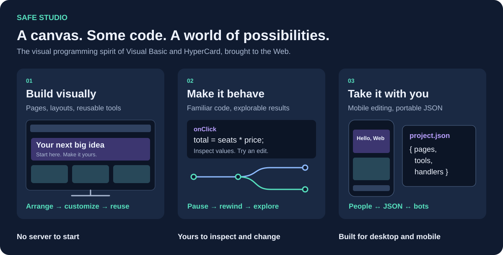
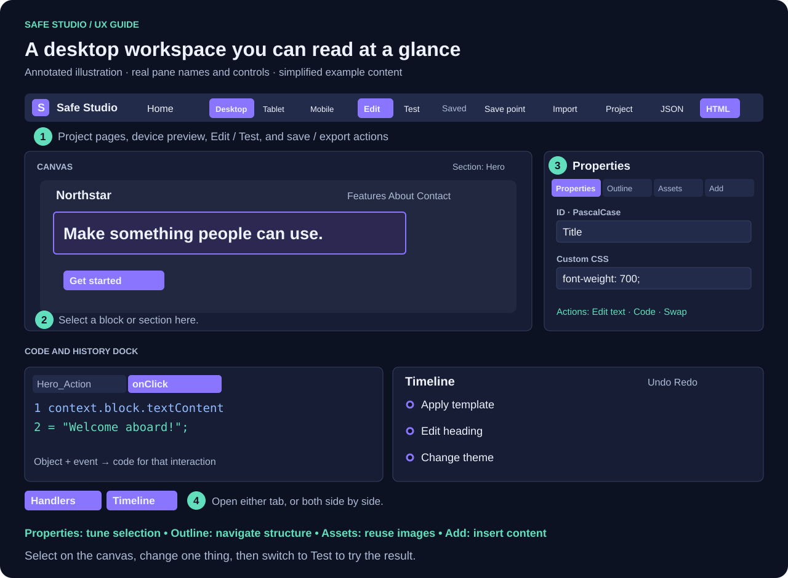
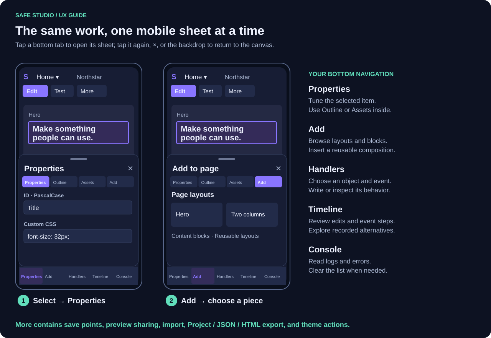
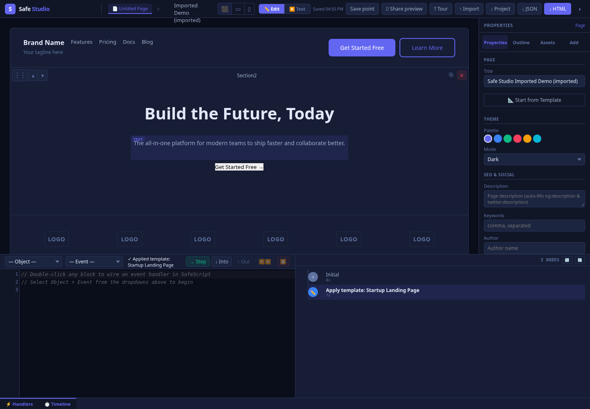

# Safe Studio

**What if Visual Basic had been built for the Web in 2027?**

Remember placing a button on a form, double-clicking it, and making something happen? Or opening a HyperCard stack and realizing you could change the program yourself?

Safe Studio brings that spirit to the browser: a visual canvas, reusable tools, familiar code, and a timeline you can explore. Build a website, give it behavior, and take it apart to see how it works. Start on a laptop or make a change from your phone. Hand the same project to a collaborator—or a bot—and keep building.



The editor runs from a **self-contained HTML file**. **No server, account, or development environment is needed to begin.** Projects, pages, and custom tools are JSON; your work can travel with you.

## Contents

- [Open it and make something](#open-it-and-make-something)
- [Know your workspace](#know-your-workspace)
- [Build pages from useful pieces](#build-pages-from-useful-pieces)
- [Create wherever you are](#create-wherever-you-are)
- [Let people and bots build together](#let-people-and-bots-build-together)
- [Make the page come alive](#make-the-page-come-alive)
- [Explore what could happen](#explore-what-could-happen)
- [Connect a living application](#connect-a-living-application)
- [See it in action](#see-it-in-action)
- [Go deeper](#go-deeper)

## Open it and make something

Download this repository and open `safe-studio-standalone.html` or `index.html` in your browser. Both contain the editor, ready to use. Or clone it:

```sh
git clone https://github.com/SafeScript/studio.git
cd studio
```

Choose a template, select something on the canvas, and make it yours. Switch from **Edit** to **Test** to try its behavior. Export your project to keep a portable copy.

## Know your workspace

The **canvas** is your page. Select a section or block, then use the right-hand **Properties / Outline / Assets / Add** inspector to change it, find it, or add something new. The lower **Handlers** and **Timeline** panes let you program interactions and explore history without leaving the page.



*An explanatory illustration using the actual pane names and arrangement, with simplified content. [See real screenshots](docs/screenshots.md) or [learn which pane to use](docs/building-pages.md#choose-the-right-pane).*

## Build pages from useful pieces

A **project** holds pages and reusable tools. A **page** contains sections; a **section** uses a layout to arrange blocks; each **block** displays content or a tool. Custom tools can contain their own sections and blocks, so small pieces can grow into whole interfaces.

Start with **98 templates, 41 layouts, and 75 tools**, then add your own. Build landing pages, portfolios, publication layouts, forms, interactive prototypes, and interfaces for community applications.

**[Explore pages, sections, blocks, layouts, and tools →](docs/building-pages.md)**

## Create wherever you are

Use the desktop canvas or the phone editor's bottom navigation and slide-up panels. Revise copy, adjust a theme, add content, or inspect a handler on the go. Give the page itself responsive grids, tabs, accordions, carousels, and drawers.



*On a phone, bring a task into view, make the change, then close its sheet to return to the canvas.*

**[Build and edit on mobile →](docs/mobile.md)**

## Let people and bots build together

A `.safestudio` project is readable JSON. Pages and tools can also be exchanged as JSON. A bot can generate a starting point, make a targeted edit, or produce variations; you can import the result and continue visually. The included **[LLM.md](LLM.md)** explains the format, layouts, tools, handlers, and reference system.

**[Save, import websites, share projects, and work with bots →](docs/projects-and-bots.md)**

## Make the page come alive

Attach event handlers written in **[SafeScript](https://github.com/SafeScript/safescript)**, a familiar subset of JavaScript with controlled access to host capabilities. It gives you variables, functions, calculations, and page interaction while restricting access to the surrounding environment.

**[Meet SafeScript: familiar code with explicit boundaries →](docs/safescript.md)**

## Explore what could happen

Pause an interaction. Inspect its values. Scrub through its sub-steps. Go back, change the logic, and continue into another future while retaining the original path. Compare the projected results before committing the chosen effects.

Inspired by the direct connection between code and results explored in Bret Victor's **[Inventing on Principle](https://www.youtube.com/watch?v=PUv66718DII&t=81s)**, the time-traveling debugger makes execution something you can explore.

**[Try time travel, forks, and edit-and-continue →](docs/time-travel-debugger.md)**

## Connect a living application

Connect Safe Studio to **[Qbix Platform](https://github.com/Qbix/Platform)** to use real tools backed by the application's users, streams, permissions, and services. Design locally, then connect your interface to the capabilities supplied by your Qbix application.

**[See what Qbix adds →](docs/qbix-platform.md)**

## See it in action



**[Browse desktop and mobile screenshots, debugging captures, and SVG illustrations →](docs/screenshots.md)**

## Go deeper

- [Build from source and run checks](docs/development.md)
- [Architecture and feature reference](SAFE-STUDIO-ARCHITECTURE.md)
- [Instructions for LLMs and bots](LLM.md)
- [SafeScript upstream](https://github.com/SafeScript/safescript)
- [Qbix Platform](https://github.com/Qbix/Platform)
- [MIT license](LICENSE)
