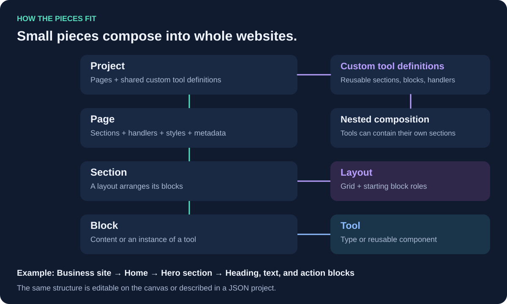
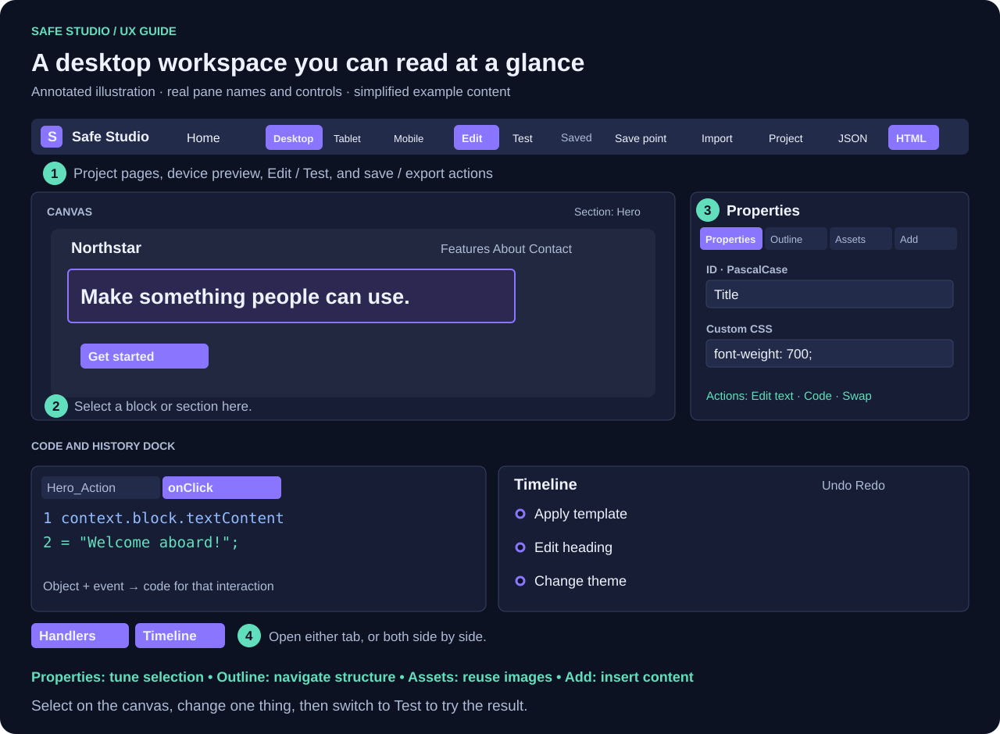
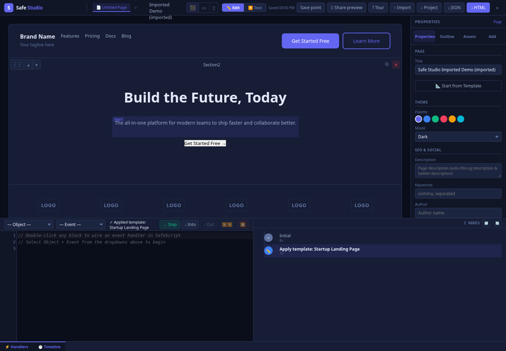
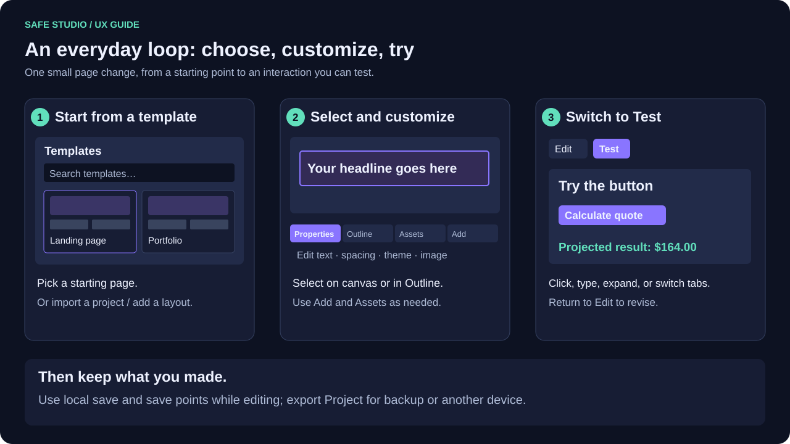
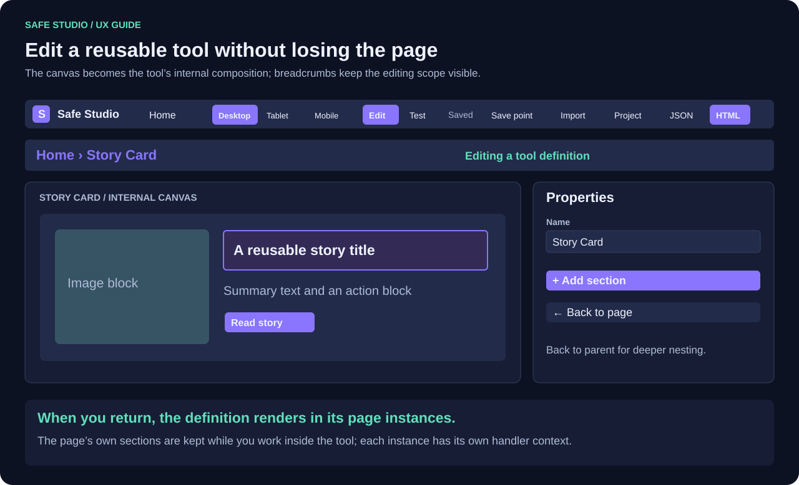
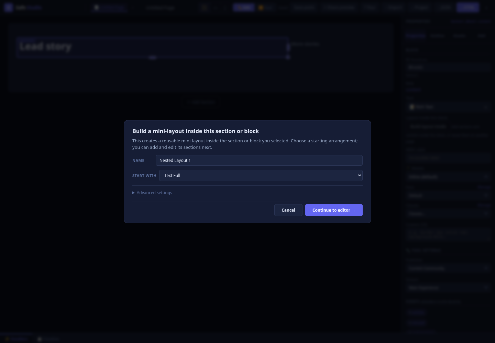

# Build pages from useful pieces

[← Safe Studio](../README.md)

Safe Studio combines a page builder with a programmable component system. You can start from a complete template, compose a page from layouts, or build a small reusable tool and use it throughout a project.

## Contents

- [The building blocks](#the-building-blocks)
- [A concrete example](#a-concrete-example)
- [Choose the right pane](#choose-the-right-pane)
- [Design and customize](#design-and-customize)
- [Reusable and nested tools](#reusable-and-nested-tools)
- [Try it](#try-it)

## The building blocks

| Piece | What it does | Example |
| --- | --- | --- |
| Project | Groups pages and reusable custom tools. | A business website with Home, About, and Contact pages. |
| Page | Holds sections, handlers, styles, theme settings, and metadata. | The Home page. |
| Section | Groups blocks into a layout region. | A hero, a feature row, or a main/sidebar region. |
| Layout | Defines a section's grid and starting block roles. | Centered hero, two columns, or sidebar-right. |
| Block | Provides content or an instance of a tool. | A heading, an image, a button, or a chat tool. |
| Tool | Defines the behavior or reusable composition used by a block. | A form control, Qbix tool, or your own contact card. |

A layout controls **arrangement**. A tool supplies **content or functionality**. A section can arrange several different tools, and a custom tool can contain its own internal section layouts.

## A concrete example

Imagine a small publication:

1. The project holds a Home page and an About page.
2. Home has a navigation section, a lead-story section, and a latest-stories section.
3. A sidebar layout places the lead story beside supporting content.
4. Blocks provide the heading, image, article summary, and action button.
5. A custom Story Card tool groups a thumbnail, title, and summary into a reusable unit.
6. Instances of Story Card appear in several sections. Its internal layout stays in the shared definition.

You can compose this visually, or describe the same structure in [JSON](projects-and-bots.md).

## Choose the right pane

*This illustration follows the actual desktop pane arrangement; the example content is simplified.*

| Where you work | What you do there | An everyday example |
| --- | --- | --- |
| Canvas | Select, arrange, and edit page content. | Select the heading you want to change. |
| Properties | Adjust the selected page, section, block, or tool. | Change spacing or open the selected block's Edit text / Code action. |
| Outline | Navigate the section/block structure. | Find a block below the visible fold or enter a nested layout. |
| Assets | Manage and reuse the page's images and alt text. | Choose an existing image rather than adding another copy. |
| Add | Browse page layouts, content blocks, and reusable layouts. | Insert a new feature section or a custom card. |
| Handlers | Choose an object and event, edit code, and inspect debugging state. | Write the button's `onClick` handler. |
| Timeline | Review authoring history and recorded event execution. | Return to an earlier design or inspect the sub-steps of a click. |
| Header | Change pages, device preview, mode, or save/export actions. | Switch to Test, then export Project when ready. |

Properties, Outline, Assets, and Add are tabs in the same inspector, rather than four permanent columns. The desktop Handlers and Timeline dock can show either pane or both side by side; clicking an already-open dock tab closes that pane.

On a phone, these jobs move into [sheets above the bottom navigation](mobile.md#which-drawer-should-i-open).

## Design and customize

Browse **98 templates**, **41 layouts**, and **75 tools** covering content, media, community, data, forms, interaction, navigation, layout, commerce, and HTML elements. Some connected tools use previews until a host provides their live service.

Select sections and blocks to adjust their content, grids, backgrounds, spacing, and properties. Move, resize, duplicate, or reorder elements. Use the Outline to find items and navigate nested structures.

Choose among six palettes and light/dark appearance, then refine fonts, colors, classes, and custom CSS. Store local images and alt text in Assets and reuse them across blocks. Page and project JSON exports carry those assets. Page properties include title, description, and social metadata for HTML export.

*An everyday loop: pick a starting point, make a focused change, try it, and save or export.*

## Reusable and nested tools

Create a custom tool to package sections, blocks, styles, and event handlers. Instances can appear in multiple places and project pages; editing the shared definition updates its instances.

Use **Create nested layout** on a block or **Add nested layout block** from section properties to begin a nested composition. Open it in the tool editor, add internal sections, and return one level at a time with Back. Custom tools can contain other custom tools.

Each instance has its own handler context: `context.tool` refers to that instance, and `context.children` refers to its child elements. This lets a reusable control operate on its own contents. Recursive rendering is bounded and circular references stop with a placeholder.

The breadcrumb tells you which definition you are editing. Inside a custom tool, the canvas and handlers act on that tool's structure. **Back to page** returns to the containing page; deeper tool nesting offers **Back to parent**. You do not need a separate editor for each component.

## Try it

1. Start with a landing-page template.
2. Change the heading and palette.
3. Add a two-column section and place content in its blocks.
4. Turn a repeated composition into a custom tool.
5. Check the [mobile layout](mobile.md), then [export your project](projects-and-bots.md).

Next: [mobile authoring](mobile.md) · [SafeScript behavior](safescript.md) · [screenshots](screenshots.md)
