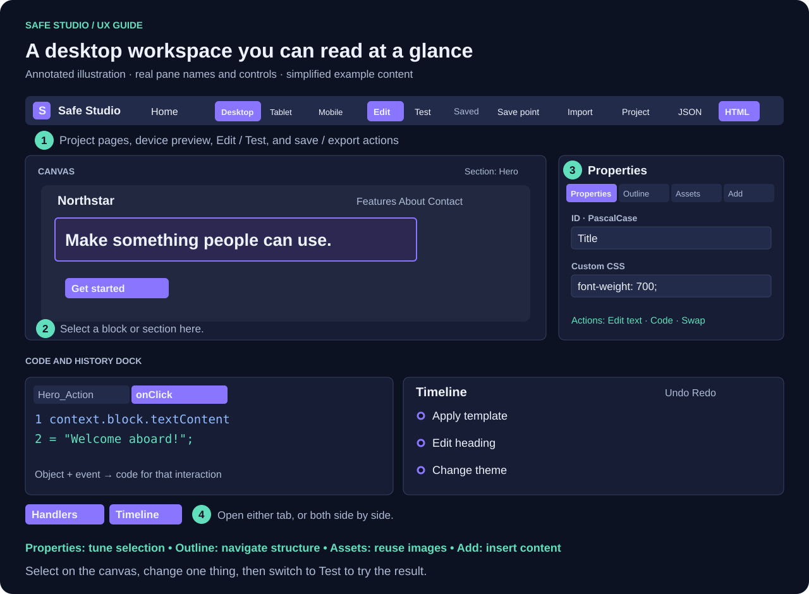

# Build and verify Safe Studio

[← Safe Studio](../README.md)

The generated HTML editor is ready to open. A development environment is needed only to change its sources, rebuild it, or run automated checks.

## Contents

- [Build](#build)
- [Source map](#source-map)
- [Checks and recorded results](#checks-and-recorded-results)

## Build

Use Node 24. From the repository root:

```sh
npm install
npm run build
```

The build bundles the included SafeScript engine, inserts the debugger UI and CSS into the shell, and produces identical `index.html` and `safe-studio-standalone.html` entry points. Edit the source files and rebuild; changes made only to generated HTML will be overwritten.

## Source map



Use the UI regions as a starting point: authoring controls and inspector behavior live in the editor shell; the execution explorer and its session coordination live in the debugger UI source.

| Path | Purpose |
| --- | --- |
| [src/editor-shell.html](../src/editor-shell.html) | Editor shell and authoring source. |
| [src/debugger-ui.js](../src/debugger-ui.js) | Event sessions, controls, projections, and execution explorer. |
| [src/debugger-ui.css](../src/debugger-ui.css) | Debugger and explorer styles. |
| [safescript](../safescript) | Included modified engine, browser bundles, and tests. |
| [build-editor.cjs](../build-editor.cjs) | Editor build. |
| [tests](../tests) | Explorer workflow and engine regression runners. |
| [LLM.md](../LLM.md) | Project format and instructions for bots. |
| [artifacts](../artifacts) | Demonstrations, implementation patch, and verification evidence. |

The engine changes use a SafeScript 2.1.0 base at upstream commit `3cc28462f25d4811735986f04d87448b6a2bab5e`. The [engine implementation patch](../artifacts/safescript-debugger.patch) is separate from the documentation patch that introduces these guides.

## Checks and recorded results

```sh
npm run test:editor
npm run test:explorer
npm run test:engine
```

Focused engine debugger checks can also be run after installing the engine's dependencies:

```sh
cd safescript
npm install
npm run test:debug
```

The [recorded explorer results](../artifacts/EXECUTION-EXPLORER-RESULTS.json) cover the actual-event pause, rewind, edit-and-continue, retained-future comparison, and narrow-screen workflow. The [engine regression results](../artifacts/engine-regressions/results.json) and per-suite logs cover the included source.

**The full engine test command exits nonzero for two inherited failing suites.** The [baseline comparison](../artifacts/BASELINE-COMPARISON.json) records the same 7 compiler and 28 battle-suite failing assertions as the untouched upstream base, with no added failing assertions in those suites. Do not describe the overall engine run as entirely green.

Browser verification used Chromium, including narrow-screen viewports. Physical iPhone, Safari, Firefox, and a live authenticated Qbix backend were not verified. The Qbix adapter checks used a runtime-shaped stub.

For current debugger behavior, start with [the debugging guide](time-travel-debugger.md) and [release guide](../DEBUGGER-RELEASE.md). The broader [architecture reference](../SAFE-STUDIO-ARCHITECTURE.md) retains older notes under a current-debugger notice. The [Streams integration document](../STREAMS-SAFESCRIPT-INTEGRATION.md) includes design proposals as well as integration background.
