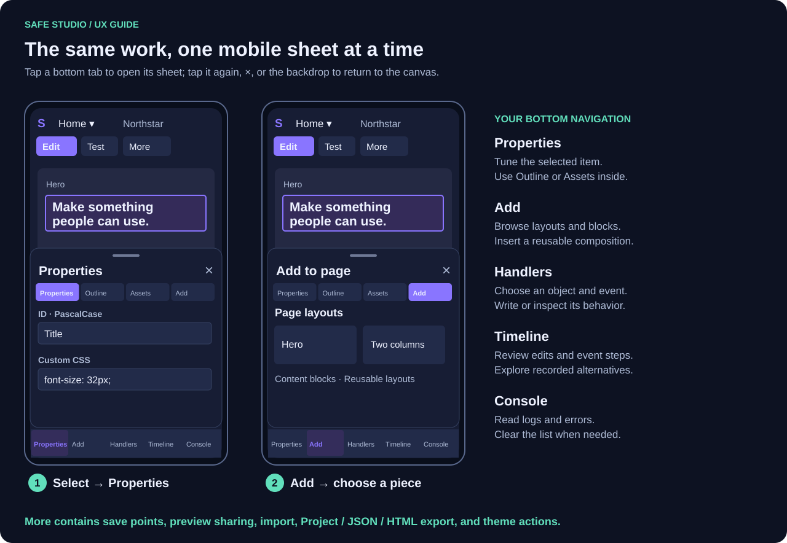
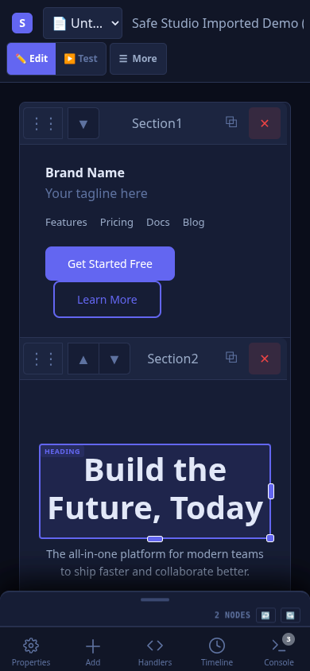

# Create on the go

[← Safe Studio](../README.md)

An idea does not always arrive while you are sitting at a desk. Safe Studio's editor adapts to a phone so you can revise a page, try an interaction, or inspect its code where you are.

## Contents

- [The editor on your phone](#the-editor-on-your-phone)
- [Which drawer should I open?](#which-drawer-should-i-open)
- [Make your pages responsive](#make-your-pages-responsive)
- [Move between devices](#move-between-devices)

## The editor on your phone

Open a hosted copy of the editor in your mobile browser. The bottom navigation gives you access to Properties, Add, Handlers, Timeline, and Console. Panels open as sheets above the navigation, leaving the canvas as the main workspace.

*Illustrated with the actual sheet and navigation names. Content and proportions are simplified for explanation.*

Use it to change text, select a different theme, add a block, or test a button. Open Handlers to adjust behavior, or Timeline to inspect history and recorded event sub-steps. The code editor and execution explorer also have narrow-screen layouts.

For a first session, open the tour, choose a template, tap a block, and change one property. Switch to Test to try the page, then return to Edit.

## Which drawer should I open?

| Bottom tab | Opens | What you normally do |
| --- | --- | --- |
| Properties | The inspector sheet, initially on Properties. | Tune the selection; use Outline to find an element or Assets to choose an image. |
| Add | The same inspector sheet, on its Add tab. | Insert a layout, content block, or reusable composition. |
| Handlers | The code sheet with object/event selectors. | Edit the selected element's behavior or inspect a paused handler. |
| Timeline | The timeline and execution-explorer sheet. | Review design changes, event sub-steps, and recorded forks. |
| Console | The log/error list, with Clear. | Read a message or error raised while working. |

Tap the active bottom tab again, use **×**, or tap the backdrop to close a sheet. Switching to another bottom tab brings that task forward. Outline and Assets are inside the inspector; they do not require extra bottom tabs.

Use the **page selector** in the header to change pages. Open **More** for save status, Quick tour, Share preview, Save point, Import, Project / JSON / HTML export, and Theme. That menu contains file-level tasks; the bottom navigation contains editing tasks.

For example: tap a heading → Properties → Edit text → revise it → close the sheet → Test. For a behavior change: select the button → Handlers → choose `onClick` → edit the code → Test.

## Make your pages responsive

The editor's mobile interface and your page's responsive behavior are separate controls. You can design a mobile page on desktop, or edit that page from a phone.

| Control | What you can choose |
| --- | --- |
| Device preview | Inspect desktop and mobile page layouts. |
| Section mobile layout | Stack blocks, or display them as accordions, tabs, or a carousel. |
| Block mobile display | Keep content inline, use an accordion/dropdown/drawer, or hide it. |
| Nested layout grids | Keep authored columns on desktop and stack on narrow screens. |

Mobile behaviors are carried into exported HTML. Try Test mode as well as the device preview: opening a drawer or switching a tab reveals details a static preview cannot.

[View an exported publication layout on mobile](../final-screenshots/nested-news-mobile.png) · [View mobile debugging](../debugger-screenshots/05-explore-fork-point-mobile.png)

## Move between devices

The editor can run locally on a computer with no server. For convenient access from a phone, serve the HTML file from a web host and open its URL. A `file:` URL on one device does not make the editor available on another.

Local saves belong to the browser and origin where you made them. Export your project, transfer the file, and import it on the next device to continue editing. A hosted Share Preview link is useful for reviewing a snapshot; it does not synchronize a shared project.

The recorded narrow-screen browser checks used Chromium viewports of 320, 360, 390, and 430 pixels. Physical iPhone, Safari, and Firefox verification remains outside those checks.

Next: [saving and sharing](projects-and-bots.md) · [debugger](time-travel-debugger.md)
