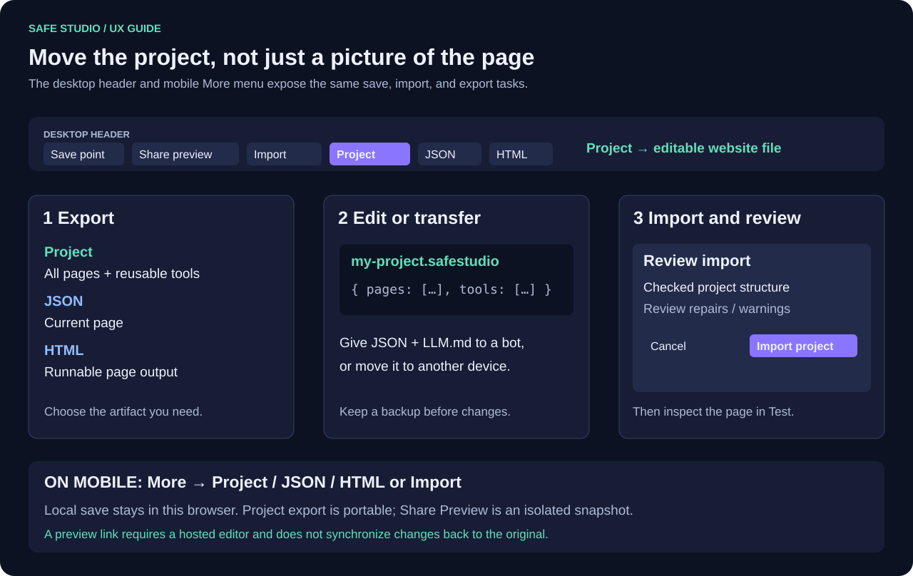

# Projects, websites, and bots

[← Safe Studio](../README.md)

The canvas is one way to edit a Safe Studio project. JSON is another. A person, script, or AI assistant can work on the same pages and tools, then open the result in the visual editor.

## Contents

- [Your project is JSON](#your-project-is-json)
- [Build with a bot](#build-with-a-bot)
- [Import existing websites](#import-existing-websites)
- [Save and exchange work](#save-and-exchange-work)

## Your project is JSON

A `.safestudio` file describes a project with pages and custom tools. A page describes its sections, blocks, handlers, styles, theme, and metadata. Handlers are SafeScript source strings within that data. Individual pages and tools can also be exported as JSON.

Here is a small project you can save as `hello.safestudio` and import:

```json
{
  "safestudio": "1.0",
  "type": "project",
  "name": "Hello Studio",
  "pages": [
    {
      "id": "home",
      "title": "Home",
      "theme": { "palette": "indigo", "bg": "light" },
      "sections": [
        {
          "layoutKey": "hero-centered",
          "customId": "Hero",
          "blocks": [
            {
              "role": "heading",
              "tool": "Streams/html",
              "customId": "Title",
              "content": "<h1>Made by people and bots</h1>"
            },
            {
              "role": "text",
              "tool": "Streams/html",
              "content": "<p>Open, inspect, and make it yours.</p>"
            },
            {
              "role": "action",
              "tool": "Streams/html",
              "content": "<button>Try me</button>"
            }
          ]
        }
      ],
      "handlers": {
        "0:2:onClick": "context.block.textContent = 'Hello!';"
      }
    }
  ],
  "tools": []
}
```

No server, MCP service, or API is required to generate or edit this file. Because the format is text, you can store it in Git, review differences, make backups, and transform it with ordinary programs. Images can be included as page assets, so JSON files may be larger than their visible text content suggests.

## Build with a bot

Give your assistant [LLM.md](../LLM.md) along with the project file. It explains the file format, layout keys, tool settings, SafeScript handlers, hierarchical references, and nested tools.

A useful instruction is:

> Read LLM.md and this project. Add an FAQ section to Home using an existing layout. Preserve the other pages, assets, tools, IDs, and handlers. Return the complete updated project JSON for import.

A practical loop:

1. Export the current project and keep a backup.
2. Give the JSON and `LLM.md` to the assistant, with the change you want.
3. Review the changed JSON. Handler keys use section/block indices, so reordering content requires care.
4. Import the result. Safe Studio validates the structure and presents supported migration warnings.
5. Inspect the page visually and test its handlers.
6. Continue editing by hand or ask for another variation.

This is file-based collaboration. It does not require a bot to click through the editor or imply automatic concurrent merging.

## Import existing websites

There are two routes:

- **Import a Safe Studio project:** bring in an entire multi-page website described by project JSON, including its reusable tools and handlers.
- **Clone Site from HTML:** paste a full page's HTML source. The client-side importer extracts supported sections, content, theme settings, and SEO metadata into an editable page.

For an existing multi-page website, import its pages individually through HTML or prepare a multi-page Safe Studio project. Clone Site currently processes the supplied page source; it does not crawl a domain, recreate an arbitrary application's server, or automatically translate its JavaScript into SafeScript. Review the imported layout and supply any needed behavior or connected services.

Both routes are available without Qbix. [Qbix integration](qbix-platform.md) can add live application tools and data after you bring in the interface.

## Save and exchange work



*The header actions and import review use the editor's actual names. The JSON card is an abbreviated illustration.*

A typical handoff is **Project export → edit or transfer the file → Import → Review import → inspect in Test**. Desktop puts these file actions in the header; mobile puts them in More.

| Format or action | Purpose |
| --- | --- |
| Local save | Continue in the current browser and origin. |
| Save point / recovery | Restore a locally recorded recovery checkpoint. |
| Project export | Back up or transfer the editable multi-page website. |
| Page JSON | Exchange a page. |
| Tool JSON | Share a reusable component definition. |
| HTML export | Produce a page with its content, styles, theme, metadata, mobile behavior, and handler runtime. |
| Share Preview | Open a bounded snapshot as an isolated Test-mode copy through a hosted editor link. |

A preview link is size-limited and requires the editor to be hosted to work across devices. Edits to a preview are separate from the original project; export them if you want to keep them. Use project export/import for device handoff.

Next: [the page model](building-pages.md) · [SafeScript](safescript.md) · [Qbix](qbix-platform.md)
