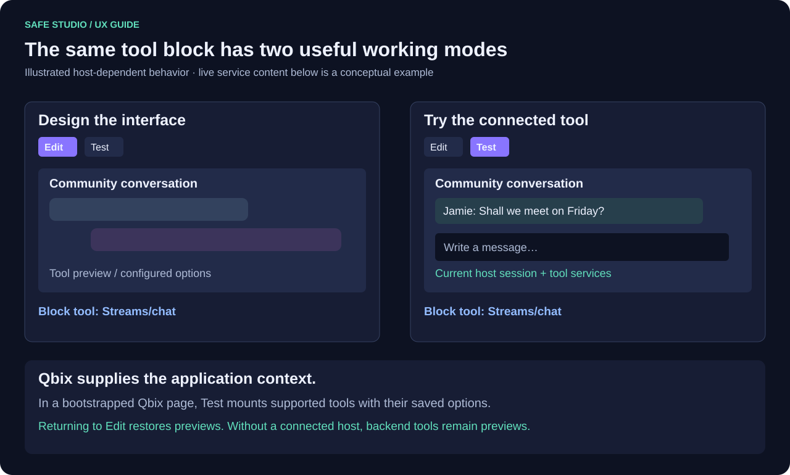

# Add a living backend with Qbix Platform

[← Safe Studio](../README.md)

Safe Studio works on its own for page design and local interactions. **[Qbix Platform](https://github.com/Qbix/Platform)** supplies an application environment: users, permissions, data, communication, and reusable tools backed by services.

The combination lets you move from designing an interface to composing an application around real people and shared data.

## Contents

- [What you gain](#what-you-gain)
- [How the connection works](#how-the-connection-works)
- [Bring an existing website](#bring-an-existing-website)
- [Current integration and next layers](#current-integration-and-next-layers)

## What you gain

| With Studio alone | With a configured Qbix host |
| --- | --- |
| Visual tools and previews | Actual Qbix tool instances using their configured options. |
| Local SafeScript behavior | Host-provided Users and Streams capabilities for application interactions. |
| Locally authored content | Stream-backed content and access rules supplied by the application. |
| Prototype community interfaces | Live tools such as chat, comments, participants, and related content where the appropriate plugins and services are installed. |
| A portable page or project | An interface that participates in the host application's identity and service model. |

Qbix and its plugins provide building blocks for accounts, invitations, real-time updates, notifications, media, and payments. Which are usable in your Studio page depends on the plugins, permissions, tool definitions, and capabilities the host makes available. Connecting the editor is not automatic setup of every service.

## How the connection works

Load Studio in the same document after your Qbix application's normal client bootstrap. The Test-mode adapter detects the tool setup, activation, and lookup APIs, mounts non-custom Qbix tools with their saved options, and includes tools inside reusable nested layouts.

Returning to Edit or rerendering disposes the mounted instances and restores the editor previews. Custom tools keep their authored composition and can contain live Qbix tool blocks.

The host supplies its existing session, configuration, tool definitions, and backend. Studio does not load app credentials or establish a new authenticated session by itself. Connected tools perform the reads and writes their normal implementations and current user permissions allow.

*The live conversation is illustrative, not a capture from a verified backend. Actual content and operations depend on the configured host.*

Day to day, you configure a block's tool options in Properties, switch to Test to interact with the mounted tool, then return to Edit to keep arranging the page. This preserves the visual authoring workflow while the host supplies the services.

## Bring an existing website

You can import an entire Safe Studio website as a multi-page JSON project, or use Clone Site to turn pasted HTML into an editable page. For other multi-page sites, import page sources individually or assemble a project describing those pages.

After importing the interface, use Qbix tools for the parts that need live data or interaction: replace a placeholder conversation with a chat tool, connect content to the appropriate stream, or supply Users and Streams capabilities to supported handlers.

The import itself runs client-side and does not require Qbix. It reconstructs supported page structure; it does not copy another application's backend, credentials, or arbitrary scripts. See [project and website import](projects-and-bots.md#import-existing-websites).

## Current integration and next layers

The tool-mounting adapter is implemented and covered with an API-shaped Qbix stub, including saved options, nested tools, status, and cleanup. A live authenticated backend was not part of that verification; test the integration in your target app.

The repository also includes a [Streams × SafeScript integration design](../STREAMS-SAFESCRIPT-INTEGRATION.md). It describes broader integration directions. Treat stream-backed editor saving, automatic collaborative editing, platform pickers, and related design proposals as separate integration work rather than features automatically enabled by the current adapter.

Resources: [Qbix Platform](https://github.com/Qbix/Platform) · [Platform developer guide](https://qbix.com/platform/guide) · [Studio architecture](../SAFE-STUDIO-ARCHITECTURE.md)
