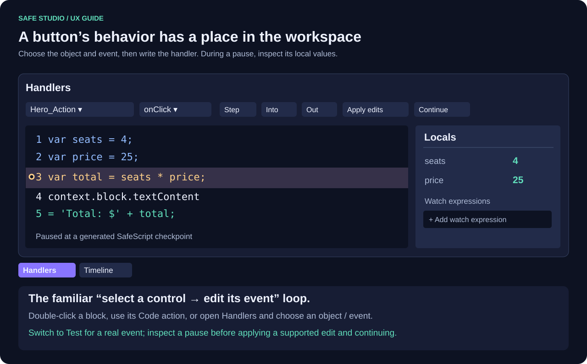

# SafeScript: familiar code, explicit capabilities

[← Safe Studio](../README.md)

**[SafeScript](https://github.com/SafeScript/safescript)** is a computational subset of JavaScript designed for code that a host application can validate and run with controlled capabilities. Safe Studio uses it for event handlers, so the code you attach to a button can be inspected and debugged inside the editor.

## Contents

- [It feels familiar](#it-feels-familiar)
- [Why it is safer to host](#why-it-is-safer-to-host)
- [The debugging foundation in v2.0.0](#the-debugging-foundation-in-v200)
- [How Studio uses it](#how-studio-uses-it)
- [Explore the language](#explore-the-language)

## It feels familiar

If you know JavaScript, you already recognize its variables, expressions, arrays, objects, functions, conditions, and loops. You do not need a new syntax for a pricing rule or click handler.

For example, in a block's `onClick` handler:

```js
var seats = 4;
var pricePerSeat = 25;
var total = seats * pricePerSeat;
context.block.textContent = 'Total: $' + total;
```

Studio supplies the handler's context. `context.block`, `context.section`, and `context.page` refer to the relevant page elements; custom tools also have instance-scoped `context.tool` and `context.children`. The editor offers contextual completions for supported references and host capabilities.

SafeScript is a subset, so some JavaScript features are intentionally unavailable. Use its documented syntax rather than assuming arbitrary JavaScript libraries can be pasted into a handler.



*An annotated handler editor, not a browser capture. The controls belong to the real Handlers pane.*

Choose the target in the object selector and the event in the event selector. You can also open a block's handler by double-clicking the block or choosing its Code action. While paused, the code line and Locals help you connect an expression with its values. Handlers is a lower dock pane on desktop and a bottom-navigation sheet on mobile.

## Why it is safer to host

The language and runtime narrow what submitted code can reach:

| Mechanism | Purpose |
| --- | --- |
| Validated grammar | Accept supported constructs rather than executing arbitrary JavaScript text. Script-level `eval` and unrestricted imports are unavailable. |
| Guarded property access | Block escape paths such as prototype and constructor-chain access, including dynamically computed keys. |
| Controlled globals | Provide curated facilities such as safe Math and JSON APIs instead of general access to `window`, `document`, or `globalThis`. |
| Explicit capabilities | Let the host decide which objects and functions a handler can use. |
| Execution guards | Bound instrumented computation with operation, time, and estimated-memory limits. |
| DOM membrane | Mediate permitted operations on page elements supplied to the script. |

These controls are designed to protect the host environment. Their usefulness depends on the capabilities the host exposes: giving a script a function that sends a message or changes backend data authorizes that function's effects. Host permissions and capability design still matter.

The included 2.1.0 base also adds regex guards, error-stack stripping, and wrapping of injected functions to avoid exposing their source. See the [upstream project](https://github.com/SafeScript/safescript) and [packaged release notes](../safescript/RELEASE-NOTES.md) for the language's security model and version details.

## The debugging foundation in v2.0.0

SafeScript v2.0.0 introduced the transactional runtime and debugging foundation: instrumented checkpoints, a pending-effect journal, stepping and inspection, and a protocol that a host UI can drive. That lets an application present debugging controls itself, without requiring the user to open browser DevTools.

Safe Studio builds on that foundation using the included 2.1.0-based engine with its continuation compiler and resumable debug sessions. Explicit execution frames retain local bindings, active calls, operands, and loop positions. Recorded checkpoints retain state, source versions, and pending-effect positions.

This distinction matters: Studio's executable seeks, independently resumable forks, and supported active-code remapping are part of its included engine changes. They should not be assumed to exist identically in every upstream v2.0.0 installation.

## How Studio uses it

1. Attach a handler to a block or section.
2. Validate and run it in Test mode.
3. Pause at a breakpoint or event entry.
4. Inspect values and step through calls.
5. Seek to a recorded checkpoint, apply a supported edit, and continue into a new future.
6. Compare projected DOM results, then commit or discard pending effects.

The engine pauses at generated SafeScript checkpoints; it does not suspend arbitrary native JavaScript midway through a host call. See [time-travel debugging](time-travel-debugger.md) for the workflow and limits.

## Explore the language

- [SafeScript on GitHub](https://github.com/SafeScript/safescript)
- [Packaged language README](../safescript/README.md)
- [Packaged release notes](../safescript/RELEASE-NOTES.md)
- [Studio handler and project formats](../LLM.md)
- [Continuation compiler source](../safescript/src/continuation-compiler.js)
- [Resumable session source](../safescript/src/continuation-debug.js)
