# Screenshots and illustrations

[← Safe Studio](../README.md)

Explore the editor on desktop and mobile. The PNGs below are actual browser captures. SVGs are explanatory illustrations, not screenshots.

## Contents

- [Authoring](#authoring)
- [Debugging](#debugging)
- [UX walkthroughs](#ux-walkthroughs)
- [Illustrations](#illustrations)

## Authoring

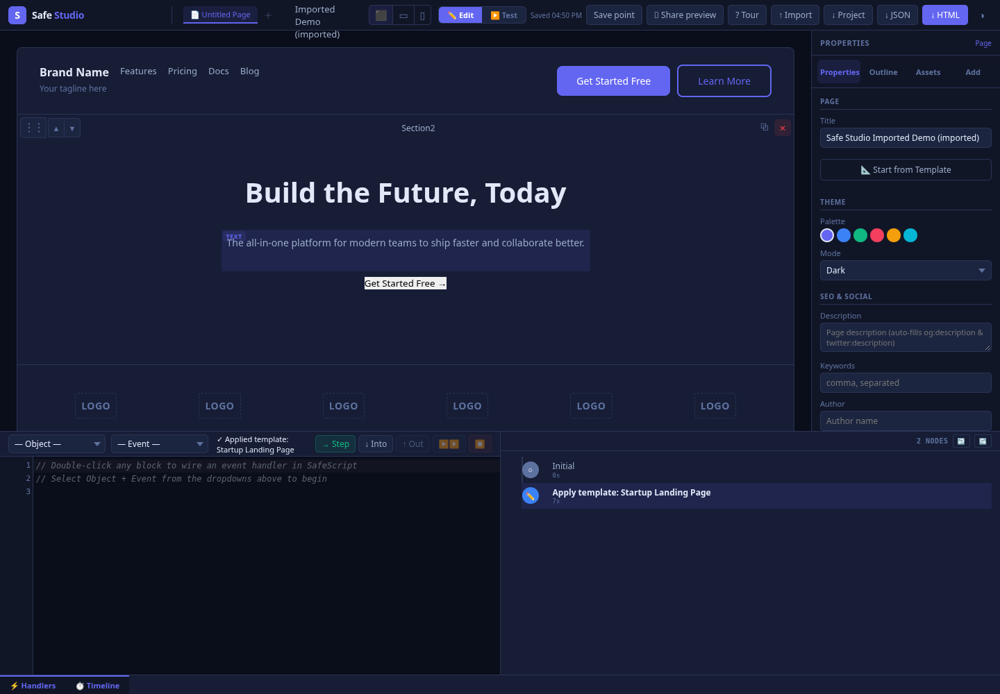

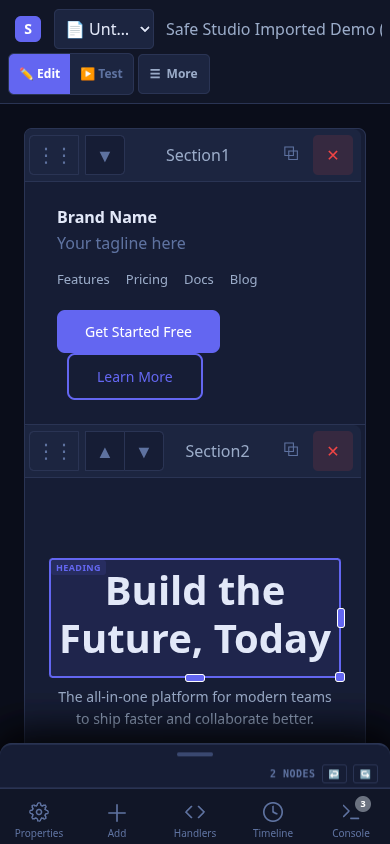

| Workflow | Desktop | Mobile |
| --- | --- | --- |
| Starting workspace | [View](../final-screenshots/01-desktop.png) | [View](../final-screenshots/01-mobile.png) |
| Template gallery | [View](../final-screenshots/02-desktop.png) | [View](../final-screenshots/02-mobile.png) |
| Landing page | [View](../final-screenshots/03-desktop.png) | [View](../final-screenshots/03-mobile.png) |
| Section properties | [View](../final-screenshots/04-desktop.png) | [View](../final-screenshots/04-mobile.png) |
| Block selection | [View](../final-screenshots/05-desktop.png) | [View](../final-screenshots/05-mobile.png) |
| Light appearance | [View](../final-screenshots/06-desktop.png) | [View](../final-screenshots/06-mobile.png) |
| Custom tool editor | [View](../final-screenshots/07-desktop.png) | [View](../final-screenshots/07-mobile.png) |
| Nested layout setup | [View](../final-screenshots/nested-layout-setup-desktop.png) | [View](../final-screenshots/nested-layout-setup-mobile.png) |
| Exported nested publication | [View](../final-screenshots/nested-news-desktop.png) | [View](../final-screenshots/nested-news-mobile.png) |
| Quick-start tour | [View](../final-screenshots/quick-start-tour-desktop.png) | [View](../final-screenshots/quick-start-tour-mobile.png) |

The authoring capture set precedes the current debugger implementation. For current execution-explorer controls, use the debugger captures below. Other historical captures remain in [final-screenshots](../final-screenshots) and [screenshots](../screenshots).

## Debugging

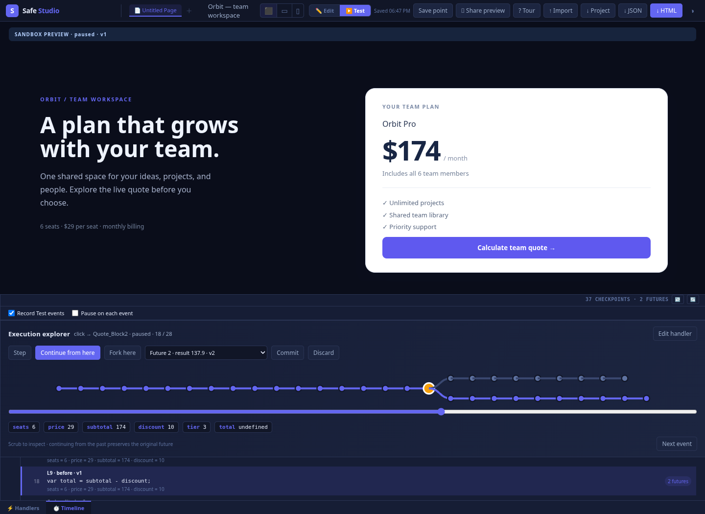

| State | Desktop | Mobile |
| --- | --- | --- |
| Paused event | [View](../debugger-screenshots/01-paused-event-desktop.png) | [View](../debugger-screenshots/01-paused-event-mobile.png) |
| Rewound timeline | [View](../debugger-screenshots/02-rewound-timeline-desktop.png) | [View](../debugger-screenshots/02-rewound-timeline-mobile.png) |
| Pending edit | [View](../debugger-screenshots/03-edit-and-continue-desktop.png) | [View](../debugger-screenshots/03-edit-and-continue-mobile.png) |
| Two retained futures | [View](../debugger-screenshots/04-forked-futures-desktop.png) | [View](../debugger-screenshots/04-forked-futures-mobile.png) |
| Exploring the fork point | [View](../debugger-screenshots/05-explore-fork-point-desktop.png) | [View](../debugger-screenshots/05-explore-fork-point-mobile.png) |

[Follow the demonstrated workflow →](time-travel-debugger.md#try-the-quote-calculator)

## UX walkthroughs

These annotated SVGs use the interface's pane names and working relationships. They simplify content and scale so you can understand the workflow before opening the application. The screenshots above remain the reference for the exact captured appearance.

### Desktop workspace

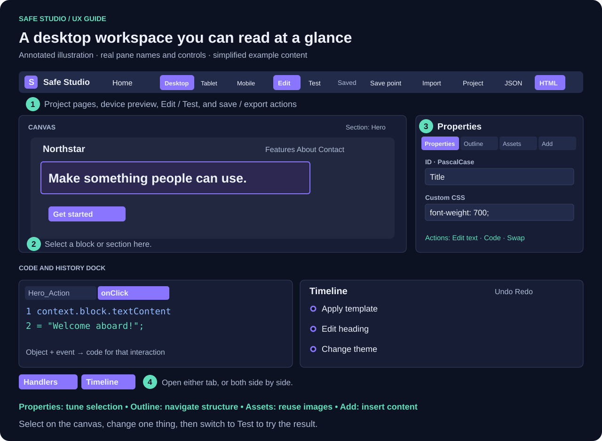

### Mobile drawers

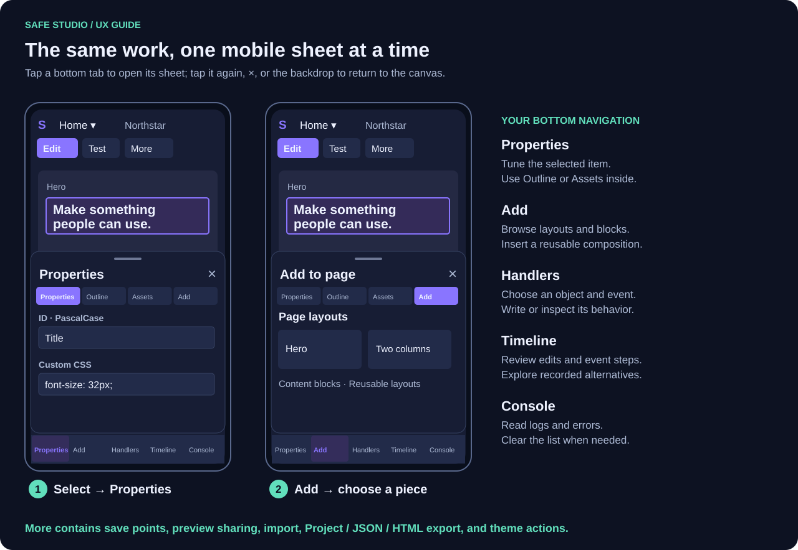

### An everyday editing loop

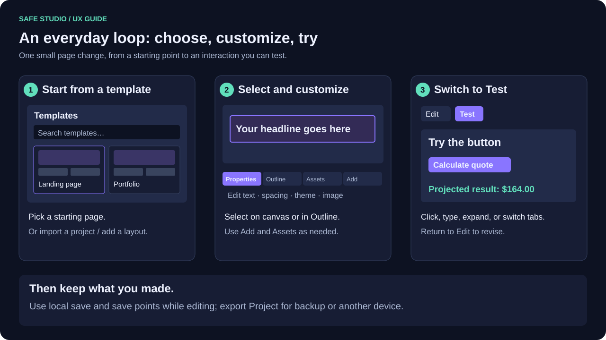

### Reusable tool editor

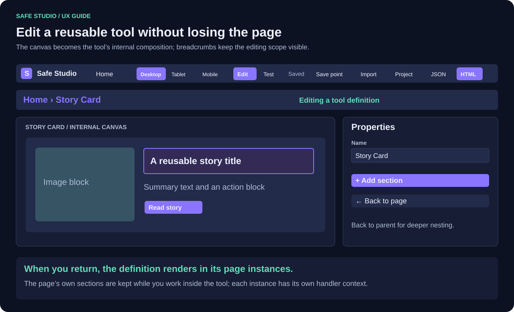

### Handler editing

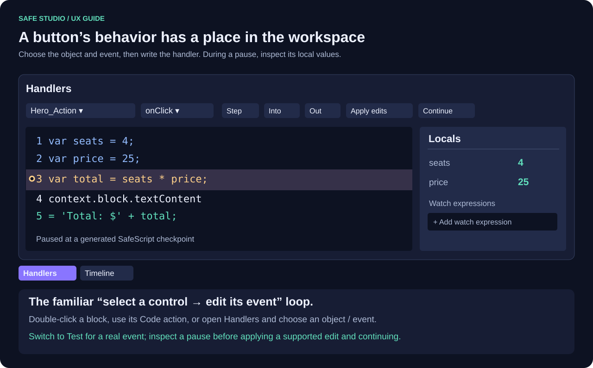

### Debugging across panes

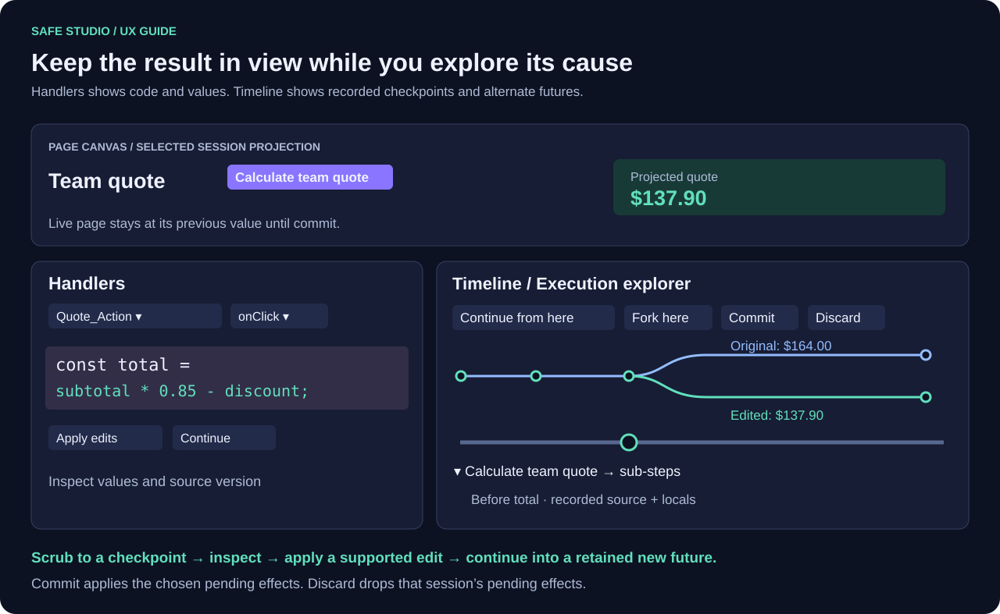

### Project handoff

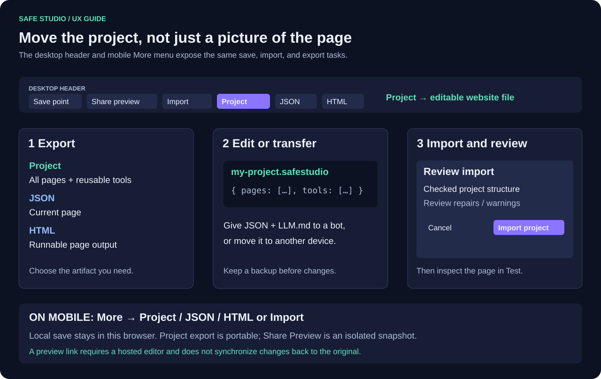

### Connected tools

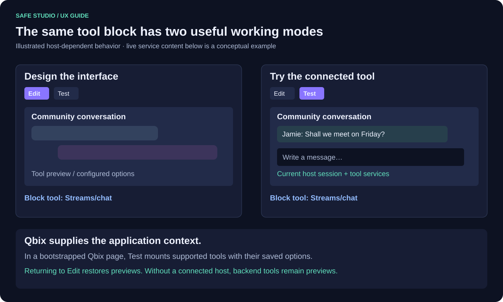

The connected conversation is a conceptual example requiring a configured Qbix host, rather than evidence of a live authenticated backend test.

## Illustrations

### The whole workspace

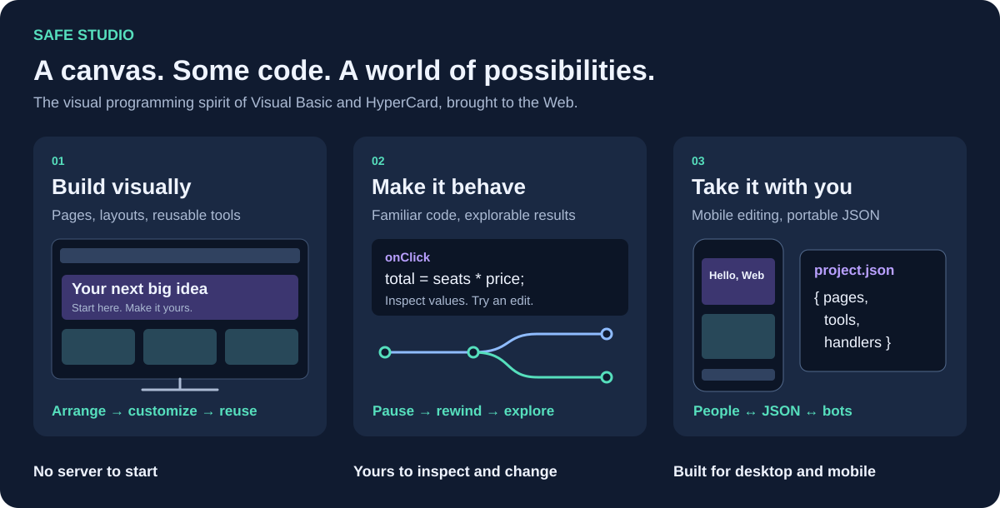

### How the pieces fit

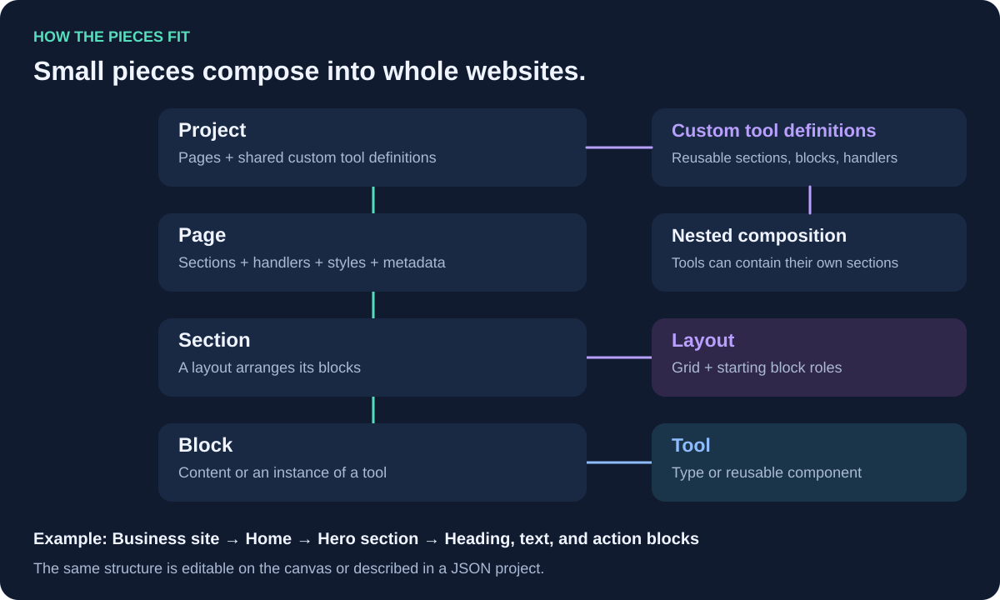

### Debugger workspace

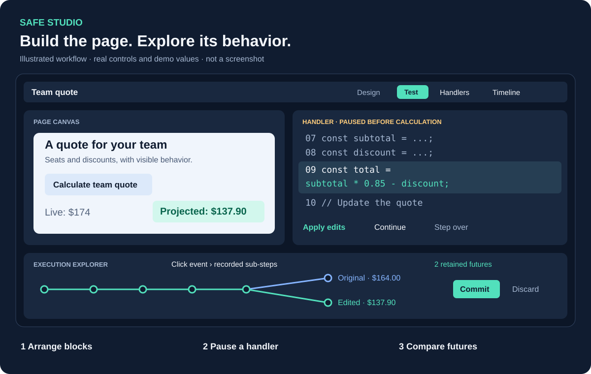

### Forked futures

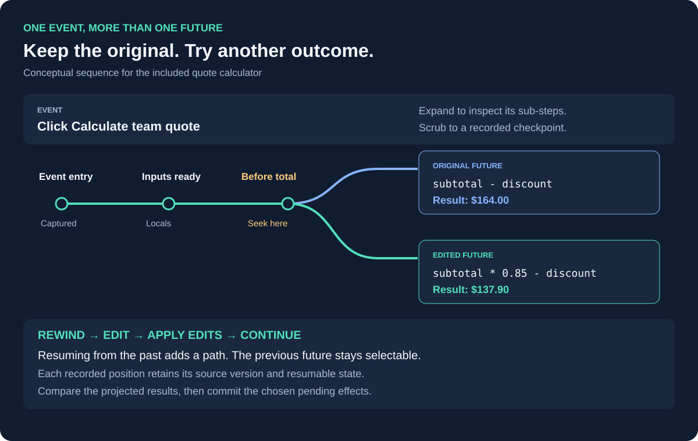

### Resumable execution

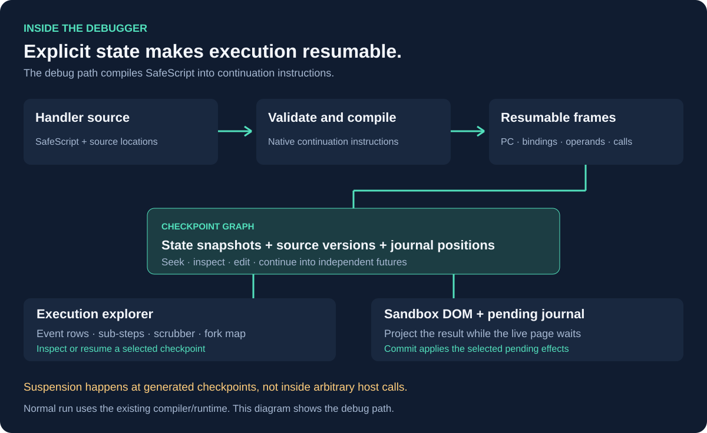
