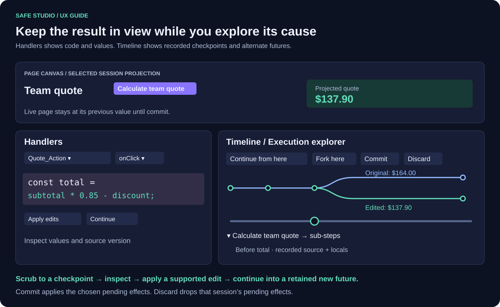
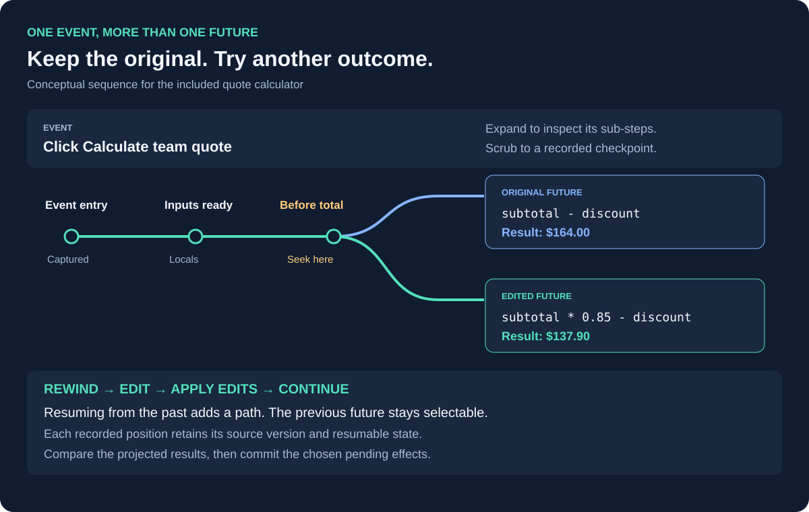
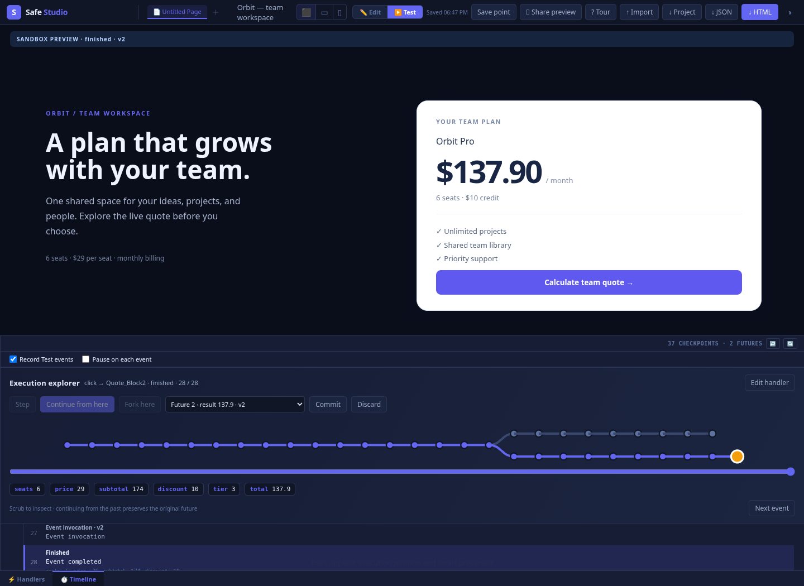
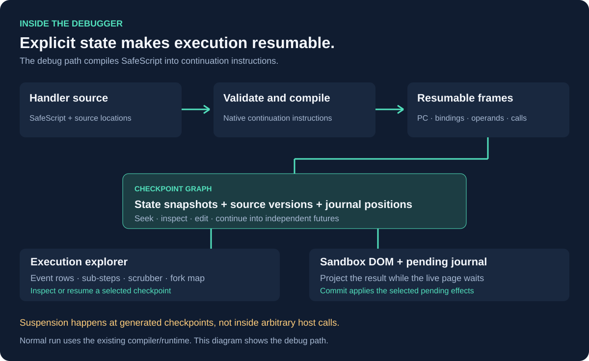

# A debugger for exploring possibilities

[← Safe Studio](../README.md)

What if debugging felt less like following a disappearing trail and more like exploring a landscape?

Safe Studio's time-traveling debugger lets you pause an interaction, examine its sub-steps, return to an earlier checkpoint, and continue into a different future. You can compare outcomes while keeping the original path available.

## Contents

- [Inventing on Principle](#inventing-on-principle)
- [Two kinds of history](#two-kinds-of-history)
- [Step, scrub, and inspect](#step-scrub-and-inspect)
- [Fork and edit-and-continue](#fork-and-edit-and-continue)
- [Try the quote calculator](#try-the-quote-calculator)
- [How it works](#how-it-works)
- [Boundaries](#boundaries)

## Inventing on Principle

Bret Victor's **Inventing on Principle** is an inspiration for the direct connection between a program and its visible results. Studio applies that spirit to inspecting page behavior and exploring alternatives.

**[Watch the talk, starting at 1:21 →](https://www.youtube.com/watch?v=PUv66718DII&t=81s)**

The thumbnail opens the video on YouTube. It works as a link in repository Markdown without relying on an embedded player.

## Two kinds of history

**Project history** records authoring actions. Undo a change and try another edit: the old design branch stays available. Jump between states or switch branches in the project timeline.

**Execution history** records checkpoints inside an event. Expand an event row to inspect its sub-steps, scrub the selected path, and use the fork map to explore alternatives. An execution fork is another path through that event, rather than a duplicate of the whole project.

## Step, scrub, and inspect

*An annotated explanation of the actual workspace controls, with simplified example content. [Compare the real captures](screenshots.md#debugging).*

Keep three things connected: **the canvas shows the projected result**, **Handlers shows the code and values**, and **Timeline shows where you are in the recorded execution**. On desktop, open both lower panes to compare them. On mobile, switch between Handlers and Timeline sheets; both refer to the selected debug session.

- Enable **Record Test events**, then trigger a block or section handler in Test mode.
- Use **Pause on each event** or a breakpoint to stop execution.
- Step into, over, or out of SafeScript calls.
- Inspect local bindings, edit supported values, and pin values for comparison.
- Open Timeline or **Explore ↗** to inspect recorded sub-steps.
- Use the scrubber, checkpoint rows, or fork map to select a recorded position.

The scrubber navigates discrete generated checkpoints. Seeking selects their matching state, source version, and projected result. Interactions arriving while a session is paused or running are queued for later handling.

## Fork and edit-and-continue

Return to a checkpoint before the calculation you want to change. Edit the handler, choose **Apply edits**, and continue. Supported edits preserve the paused local bindings, active calls, loop state, and already-computed operands.

Continuing from the past preserves the old future. Use the recorded-futures selector or map to compare paths and their source versions. **Fork here** marks an explicit fork at a selected position.

The session runs its DOM changes against a detached sandbox. Studio projects that selected result onto the canvas. **Commit** applies its pending effects to the live page; **Discard** drops that session's pending effects.

## Try the quote calculator

1. Import [artifacts/debugging-demo.json](../artifacts/debugging-demo.json).
2. Open the right-hand block's `onClick` handler and set a breakpoint on line 9.
3. Select Test, keep Record Test events enabled, and click **Calculate team quote**.
4. Inspect `seats`, `subtotal`, and `discount`. Expand the event in Timeline or open Explore.
5. Continue: the original future returns **164**, shown as **$164.00** in the projection. The live page remains at **$174** until commit.
6. Seek back before the total calculation. Change `subtotal - discount` to `subtotal * 0.85 - discount`.
7. Choose Apply edits and Continue. The edited future returns **137.9**, shown as **$137.90**.
8. Switch between the retained futures, compare their results, and commit the one you want—or discard its effects.

[All desktop/mobile debugger captures](screenshots.md#debugging)

## How it works

[SafeScript's debugging foundation](safescript.md#the-debugging-foundation-in-v200) provides checkpoints, transactional effects, and host-driven controls. Studio's included continuation compiler and session engine keep explicit execution frames and independent snapshots, allowing in-memory state restoration and independent fork execution.

The engine validates and maps active continuation positions before replacing code. Unsupported edits leave the previous session resumable. See the [compiler](../safescript/src/continuation-compiler.js), [session engine](../safescript/src/continuation-debug.js), and [release guide](../DEBUGGER-RELEASE.md).

## Boundaries

- History is executable in memory. Session JSON is an inspection export, not restoration of a paused session after reload.
- The engine pauses at generated SafeScript checkpoints, not inside arbitrary native JavaScript calls.
- Active parameter changes, deleted continuations, and ambiguous remapping are rejected.
- Unknown host calls establish rewind barriers. Discard does not undo arbitrary external actions. Opaque host callbacks require adapters.
- Commit establishes a boundary for related branches based on the previous live state.
- History defaults to 4,096 checkpoints and an estimated 64 MiB snapshot budget, alongside execution guards.

This gives Studio tested edit-and-continue workflows inspired by the accessibility of classic visual environments; it is not a claim of exhaustive Visual Basic feature parity.
